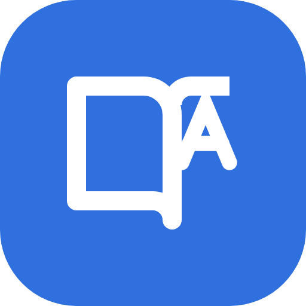
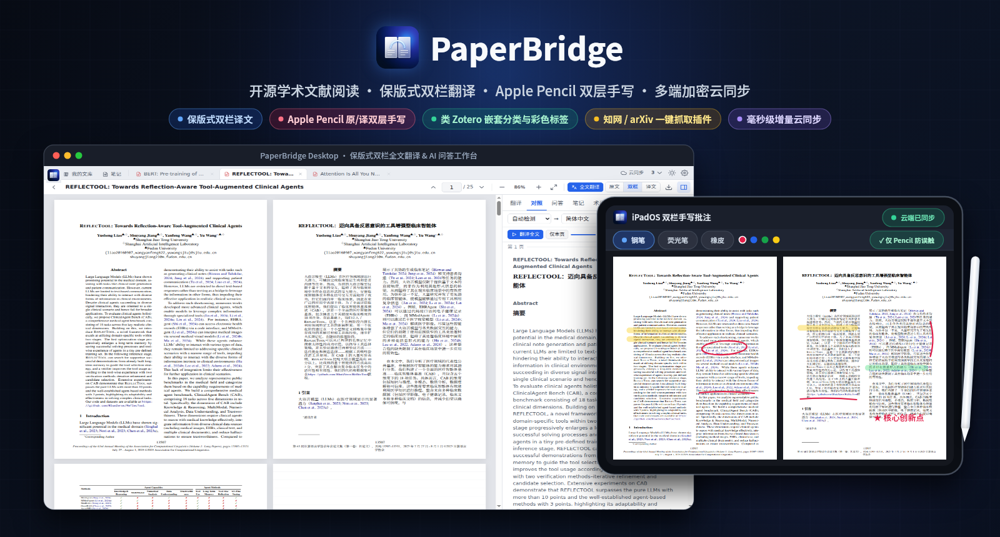
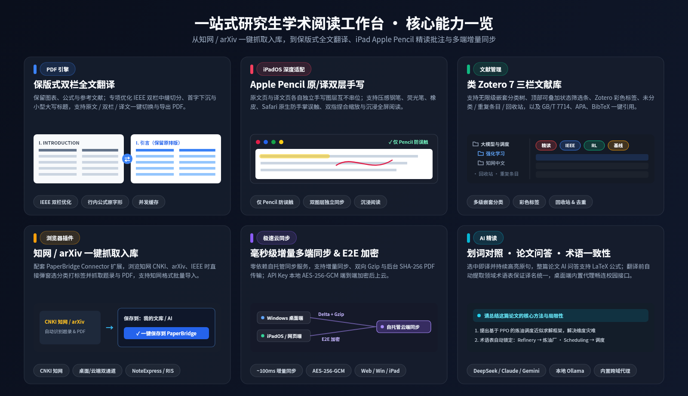
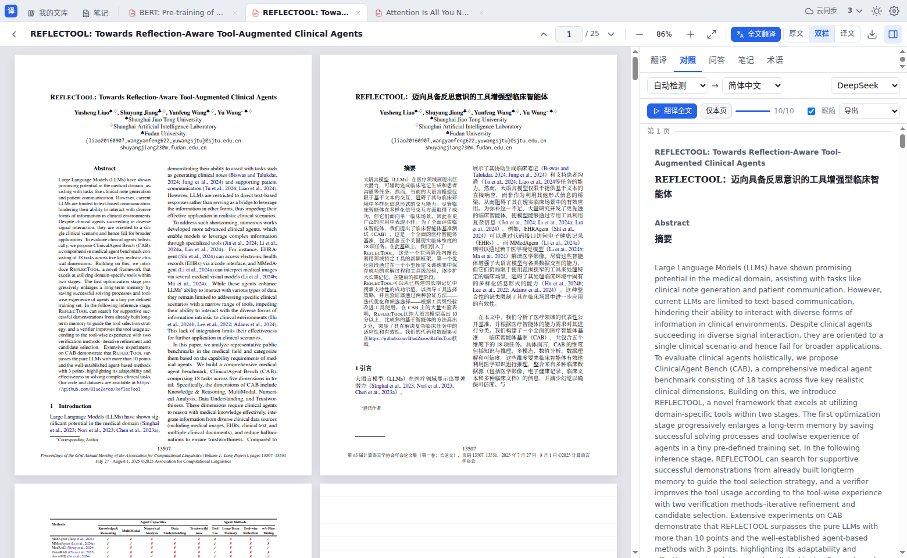
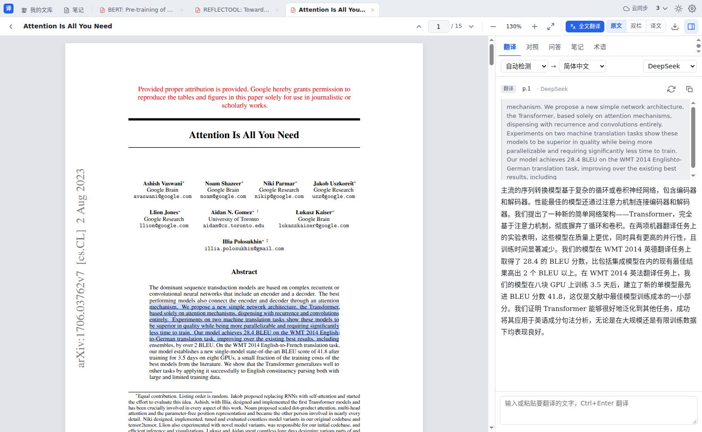
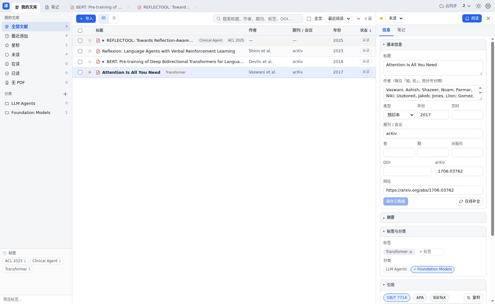
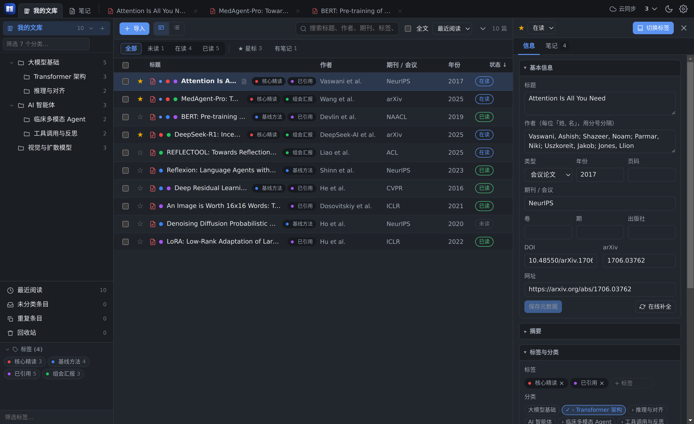

<div align="center">



# PaperBridge

**专为研究生与科研人员打造的开源文献阅读 · 保版式双栏翻译 · Apple Pencil 手写 · 多端同步工作台**

[](https://github.com/royhang/PaperBridge/releases)
[](https://github.com/royhang/PaperBridge/actions/workflows/ci.yml)
[](LICENSE)

[在线体验](https://royhang.github.io/PaperBridge/) · [Windows 免安装版 & 浏览器插件下载](https://github.com/royhang/PaperBridge/releases) · [浏览器代理部署](proxy/README.md)

</div>



---

## 核心能力一览



| 模块 | 核心特性 |
| --- | --- |
| 📄 **保版式双栏全文翻译** | 原位替换译文、保留原论文版式与图表/公式/参考文献；专项优化 **IEEE 双栏中缝切分、首字下沉（Drop-Cap）与小型大写标题**；支持「原文 / 双栏 / 译文」切换、并发翻译与本地缓存、导出「仅译文 / 左右对照 / 双语交替」PDF |
| ✏️ **iPadOS & Apple Pencil 双层手写** | 深度适配 iPadOS PWA：支持**原文页与译文页各自独立手写图层**（互不遮挡串位）、压感钢笔、荧光笔、橡皮、Safari 原生防手掌误触（仅 Pencil 落笔，手指自由翻页/双指缩放）及阅读器「沉浸模式」 |
| 🗂️ **类 Zotero 7 三栏文献库** | 多级嵌套分类树、顶部可叠加状态筛选条（未读 / 在读 / 已读 / 星标 / 有笔记 / 无 PDF）、Zotero 彩色标签、未分类 / 重复条目 / 回收站（软删除可恢复）、多文献标签页切换、`GB/T 7714 / APA / BibTeX` 一键引用 |
| 🧩 **知网 / 学术站一键抓取插件** | 配套 Chrome / Edge 扩展 **PaperBridge Connector**（`extension/`）：浏览**知网（CNKI）、arXiv、IEEE、Nature** 等页面一键选分类、打标签并抓取题录与 PDF（支持桌面端本地直连 + 云端同步直连）；支持知网 GB/T 7714、NoteExpress、EndNote、RIS 批量导入与 `标题_作者.pdf` 自动匹配 |
| ☁️ **毫秒级增量多端云同步** | 零依赖自托管同步服务（`sync/server.mjs`）：网页版 · Windows 桌面端 · iPadOS 双向同步文献、PDF（SHA-256 去重后台传输 + 打开按需秒下）、分类、彩色标签、笔记、双层手写笔迹与翻译缓存；**增量同步 + 双向 Gzip**，API 配置本地 **AES-256-GCM 端到端加密**后同步 |
| 💬 **划词高亮 · AI 问答 · 术语表** | 划词流式翻译/解释并持续高亮原句；整篇论文 AI 问答（支持 Markdown 与 LaTeX 公式）；全文翻译前自动提取领域术语表保证译名统一；桌面端内置 Chromium Happy-Eyeballs 跨域代理，直连学校/中转接口零配置 |

---

## 实拍界面预览

### 保版式双栏全文翻译 + 多文献标签页 + 逐段对照


### 划词翻译与左侧持续高亮对照


### 类 Zotero 7 三栏文献库（浅色 / 深色模式）
| 浅色模式 | 深色模式 |
| --- | --- |
|  |  |

---

## 支持的 API 服务

| 类型 | 服务 | 浏览器直连 |
| --- | --- | --- |
| OpenAI 兼容 | OpenAI、DeepSeek、Kimi、通义千问、智谱 GLM、硅基流动、OpenRouter、高校接口、Ollama / vLLM / LM Studio 本地模型… | ✅（跨域受限接口可走内置/自建代理） |
| Anthropic | Claude | ✅ |
| Google | Gemini | ✅ |
| 机器翻译 | Google Cloud Translation | ✅ |
| 机器翻译 | DeepL、百度翻译、有道智云 | ❌ 需[跨域代理](proxy/README.md)（桌面端内置免配置） |

在「设置 → API 服务」中支持一键选择常用服务商、搜索筛选模型列表，以及直接粘贴 `URL + Key`、`.env`、`curl` 命令自动识别填入；可分别指定「翻译服务」与「问答用大模型」。

---

## 全端使用指南

### 1. 桌面客户端（Windows 免安装 / macOS / Linux）
- 直接在 [GitHub Releases](https://github.com/royhang/PaperBridge/releases) 下载 `PaperBridge-<版本>-win-x64.zip`，解压运行 `PaperBridge.exe` 即可。
- **内置跨域代理**（自动复用系统代理与 IPv4/IPv6 Happy Eyeballs，学校接口 / DeepL / 百度 / 有道开箱即用）；**中文字体随包内置**；支持本地端口 `127.0.0.1:23129` 与浏览器插件秒级联动。

### 2. 知网 / 学术站一键入库扩展（PaperBridge Connector）
1. 在 [GitHub Releases](https://github.com/royhang/PaperBridge/releases) 下载 `PaperBridge-Connector-<版本>.zip` 并解压（或直接加载仓库 `extension/` 目录）。
2. 在 Chrome / Edge 打开 `chrome://extensions` 开启「开发者模式」，点击「加载已解压的扩展程序」。
3. 在知网、arXiv、IEEE 等论文页面点击插件图标，即可像 Zotero Connector 一样选分类、打标签并一键入库。

### 3. iPadOS 全屏阅读与 Apple Pencil 手写
1. 在 iPad Safari 打开你部署的 PaperBridge 地址（或 GitHub Pages），点击「分享 → 添加到主屏幕」。
2. 登录「云同步」账号即可自动拉取电脑端全部文献、PDF、翻译缓存与加密 API 配置。
3. 点击工具栏画笔按钮开启手写模式（默认开启 **「仅 Pencil 防误触」**，手掌与手指可自由滚动/双指缩放，Apple Pencil 在**原文页和译文页**上均可独立书写批注）。

### 4. 本地开发与自托管部署

```bash
pnpm install
pnpm dev          # 本地开发 http://localhost:5173
pnpm build        # 构建静态站点到 dist/
pnpm proxy        # 启动跨域代理（默认 127.0.0.1:8787）
pnpm sync         # 启动零依赖多端云同步服务（默认 127.0.0.1:8788）
pnpm desktop:win  # 打包 Windows 便携版 → desktop/release/
```

---

## 隐私与数据归属

- **本地优先**：PDF 原文件、题录、笔记、手写笔迹与翻译缓存默认存储在本地浏览器 / 桌面端 IndexedDB 中，完全离线可读。
- **端到端加密云同步**：仅在你主动登录自托管云同步服务时才同步到你的服务器（`/var/lib/paperbridge-sync/`）；API Key 在上传前使用你的账号密码在本地通过 PBKDF2 + AES-256-GCM 加密，服务端不保存任何明文 Key。

---

## 开发与测试

```bash
pnpm test         # 全量单元测试（PDF 排版引擎、文献库、手写图层、知网解析、适配器等）
pnpm test:proxy   # 跨域代理测试
pnpm test:sync    # 增量云同步 + Gzip + 权限隔离测试
pnpm lint         # oxlint 静态检查
```

## License

MIT

### 致谢

- 「保版式译文 PDF」的思路参考了 [PDFMathTranslate](https://github.com/PDFMathTranslate/PDFMathTranslate)（AGPL-3.0）；本项目使用 TypeScript（`pdf-lib` + 自研内容流解析与版面引擎）完全独立实现。
- 中文字体：[Noto Serif SC](https://fonts.google.com/noto/specimen/Noto+Serif+SC)（SIL Open Font License 1.1），构建时由 `scripts/fetch-fonts.mjs` 下载并通过 [HarfBuzz](https://github.com/harfbuzz/harfbuzz) 子集化后嵌入 PDF。
